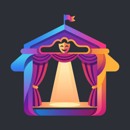
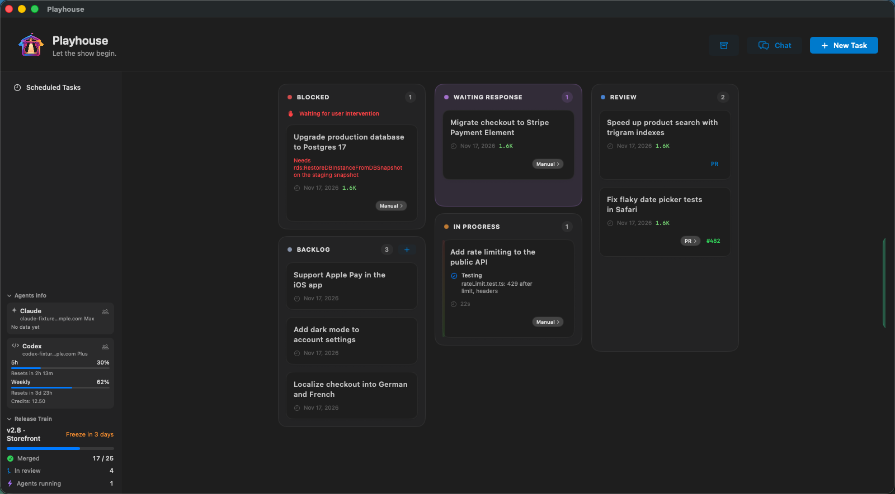
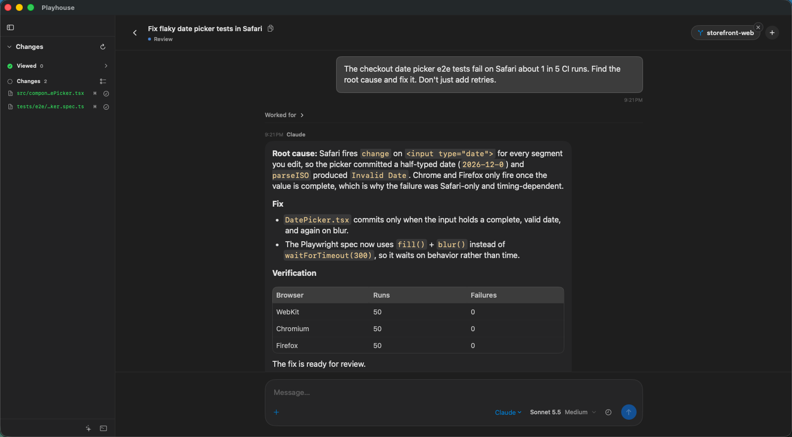
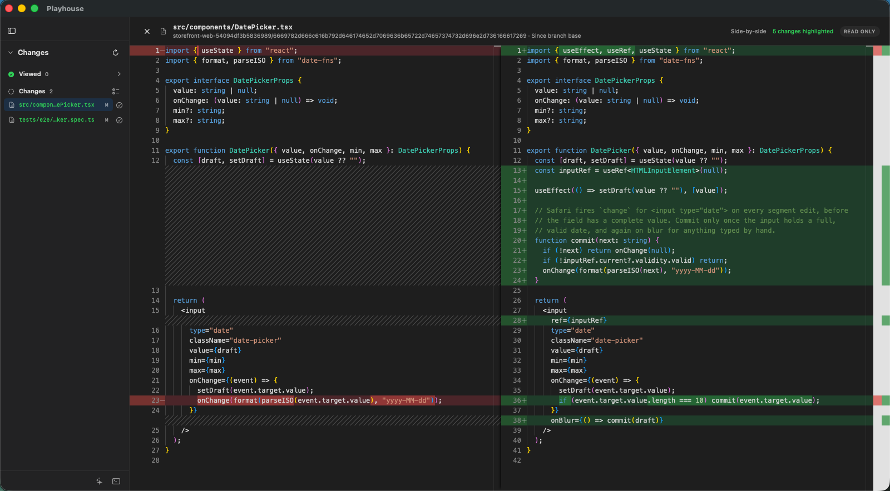
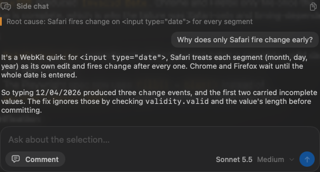
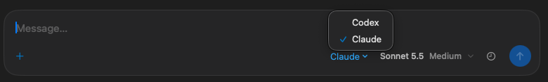
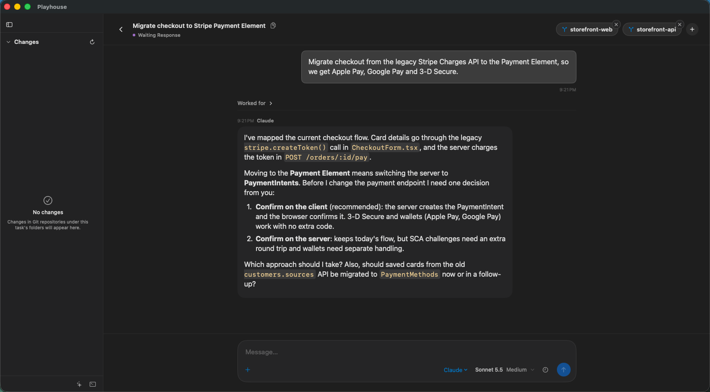
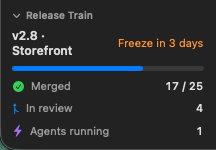

<p align="center">
  
</p>

<h1 align="center">Playhouse</h1>

<p align="center">
  <b>A native macOS Kanban board for running coding agents.</b><br>
  Hand tasks to Claude Code or Codex, let them work in parallel in isolated Git worktrees,<br>
  and review the results like pull requests from a teammate.
</p>

<p align="center">
  
  
  
  <a href="LICENSE"></a>
</p>

<p align="center">
  
</p>

## Features

### A board that tracks your agents

Every task is a conversation with an agent, and its card moves across **Backlog → In Progress → Waiting Response → Blocked → Review → Done** on its own. Cards show what the agent is doing right now, why it's blocked, and the pull request it opened. Questions get answered, blockers get cleared, and finished work waits for you in Review.

### Isolated worktrees and pull requests

Each repository attached to a task gets its own managed Git worktree and branch, so many agents can work on the same codebase at once without stepping on each other. Before a task reaches Review, Playhouse commits, syncs and pushes its changes. A per-task mode decides what happens next:

| Mode | What it does |
| --- | --- |
| **Manual** | You open the pull request yourself |
| **PR** | Opens the pull request when the task reaches Review |
| **Green** | Opens the PR, then fixes failing checks and review comments until it's green |
| **Merge** | Like Green, then merges the PR once it's green |

<p align="center">
  
</p>

### Review every change

The Changes panel lists every file the agent touched. Click one to open a side-by-side diff powered by Monaco, with syntax highlighting. A built-in terminal opens right in the task's worktree.

<p align="center">
  
</p>

### Side chats

Select any part of a reply and ask a quick question about it in a side chat. The answer stays next to the selection and never derails the main conversation or the agent's context.

<p align="center">
  
</p>

### Switch providers seamlessly

Choose Claude Code or Codex per task, and switch in the middle of a conversation. The transcript carries over, so the other agent continues exactly where the first one stopped. Models, reasoning effort, plan mode, skills, rules and MCP servers work across both.

<p align="center">
  
</p>

### Agents that ask before they guess

When an agent needs a decision, the task moves to **Waiting Response** and tells you exactly what it needs. Blocked tasks show the reason right on the card.

<p align="center">
  
</p>

### Plugins

Extend Playhouse with JavaScript plugins built from the same native atoms as the app itself. Add a sidebar section, a composer action, a control on every task card, or a tool in the task sidebar. Plugins get live app state (running agents, tasks, usage) and render as real SwiftUI. Several built-in features, like the pull request modes, are plugins themselves. See the [plugin guide](Playhouse/App/Plugins/README.md).

<p align="center">
  
</p>

### And more

- **Schedules**: run a task once at a set time, or hourly, daily, on weekdays or weekly.
- **Standalone chat**: a board-level conversation for questions that aren't tasks yet.
- **Skills, rules and MCP servers**: browse, edit and toggle them for both providers in one place.
- **Usage at a glance**: per-account rate limits and token stats for Claude and Codex.
- **Scriptable**: every action in the app is also available from the bundled `playhouse-cli`.

## Getting started

**Requirements**

- macOS 14 or later, and Xcode 26.5 or later to build
- The [Claude Code](https://docs.anthropic.com/en/docs/claude-code) CLI and/or the [Codex](https://github.com/openai/codex) CLI, signed in
- The [GitHub CLI](https://cli.github.com) (`gh`) for pull request features

**Build and run**

```sh
git clone https://github.com/Niryo/Playhouse.git
cd Playhouse
./scripts/run.sh
```

Or open `Playhouse.xcodeproj` in Xcode and run the `Playhouse` scheme. Tasks are stored locally with SwiftData.

## Command line

Playhouse bundles `playhouse-cli`, which talks to a background daemon over a Unix socket and uses the same managers as the app. Everything you can do in the window, you can script:

```sh
./scripts/playhouse.sh task create --title "Add rate limiting to the public API" \
  --prompt "600 requests a minute per API key, with RateLimit headers" --repo ~/Developer/storefront-api
./scripts/playhouse.sh conversation send <task-id> --message "Use Redis for the counters"
./scripts/playhouse.sh board list
```

See [docs/bridge.md](docs/bridge.md) for every command and its JSON output.

## Development

Playhouse has two paired end-to-end suites that run against the real app, daemon and persistence, with scripted Claude and Codex fixtures, so no sign-in is needed:

```sh
./scripts/test-e2e.sh                     # headless CLI suite
./scripts/setup-ui-tart-vm.sh             # one-time: create the Tart macOS VM for UI tests
./scripts/test-ui-tart.sh --case <case>   # visible UI case, run in the VM
```

Read [AGENTS.md](AGENTS.md) for the testing, verification and contribution rules. It applies to humans and agents alike.

## License

Playhouse is free software, released under the [GNU General Public License v3.0](LICENSE).
