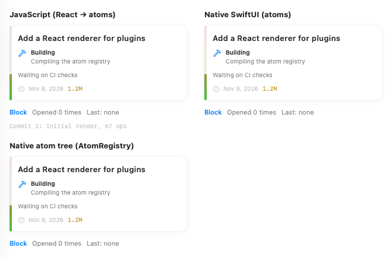
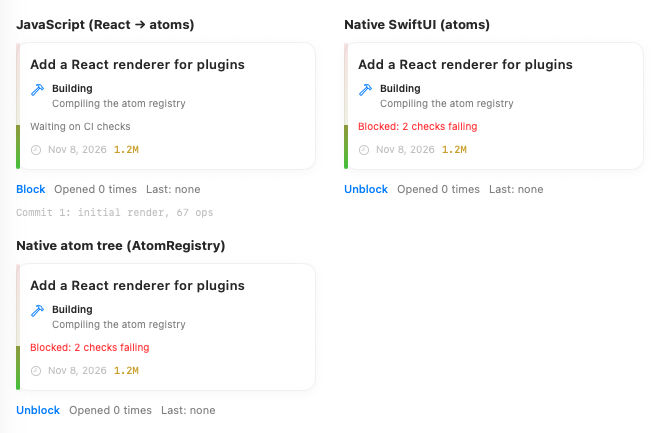
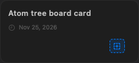

# Atom trees instead of hand-written SwiftUI: what it costs

A spike (task "Spike: convert task item to an atom tree and stress-test the cost") to decide
whether every native composite, the conversation transcript included, should be described as an
atom tree rendered through `AtomRegistry`, so a Linux port only rewrites the ~30 atoms.

**Recommendation: convert the small composites, keep the transcript (and the terminal) native.**
The board's task item costs little more as a tree (0–14% to open, ~6% memory, 4–8% per live
update on a normal board, no difference in interaction). The transcript as a tree costs 2–6×
the time and ~3× the memory at 5,000 messages, its streaming cost grows with conversation length,
and, decisively, a tree inside a lazy Scroll atom does not reliably redraw when its nodes change.
Details and the cost of the alternatives are in [Recommendation](#recommendation).

## What was built

- **Task item as a tree, behind a switch.** `PLAYHOUSE_TASK_ITEM_RENDERER=tree` draws the board's
  cards from `TaskItemTree` (Foundation-only, `Plugins/Core`), built in Swift with typed props and
  kept current by a reconciler (`TypedAtomTree` in `AtomTreeSpec.swift`); `tree-dynamic` sends the
  same tree the way a JavaScript plugin's tree arrives (dictionary props, checked and decoded once
  per node). Native stays the default. The tree has the same structure as the native card: both
  evaluate exactly the same number of atom bodies when a board opens (5,311 for 500 cards).
- **No new atoms were needed.** Two pieces were added instead: a native *slot*
  (`AtomNodeSpec.slot`), so the board's plugin row (a native view) can sit inside the tree, and a
  host-driven once-a-second *tick* for the working card's clock, because atoms have no clock.
- **Transcript prototype (benchmark only).** `TranscriptTreeBenchmark.swift` (compiled only with
  `PLAYHOUSE_ATOM_BENCHMARK`) draws the same transcript five ways: `native` (the real reply body,
  user bubble and tool-call row), `tree` (one typed tree per message under one lazy Scroll atom, so
  a streamed update reconciles only the last message), `tree-dynamic` (the same as plugin-style
  ops), `tree-full` (the whole transcript one tree, rebuilt from the model on every update, as a
  pure-function composite would be) and `tree-blocks` (one Markdown atom per block, to see how cost
  grows with node count). Messages mix long Markdown, code blocks, tables and tool calls.
- **Already landed before this spike:** PR #387 (decode props once, typed props). Every tree
  number here is on top of it; the old decode-in-`body` renderer no longer exists. For reference,
  #387 measured streaming updates at 12–14 ms instead of 21 ms, and scrolling a 500-card list went
  from 11,396 decodes to none.

After Block (native and tree change the same way; the JavaScript example keeps its own state):

A real board card drawn from the tree, with its plugin-row slot:

## How it was measured

In plain words: a special build of the app opens a board (or a transcript) by itself, does a fixed
sequence of things (open, scroll to the end and back, change cards, hover, click, open menus,
stream a reply), times each step from inside the app, and writes the numbers to a file. Every run
is a fresh app process. Each variant runs the same steps, alternating, so a slow moment on the
machine hits all of them alike. The summary is the **median** of the runs (the typical run) and, in
the raw tables, the **worst** run.

- **Where:** all runs that decide the comparison ran in the shared Tart VM (`playhouse-ui`, a
  virtual Apple M2 Pro with 6 cores, 12 GB, macOS 26.6.2), one after another with nothing else in
  it. A VM has no real GPU and adds overhead, so its numbers are only meaningful **relative to each
  other**. A smaller confirmation round ran on the host (Apple M2 Pro, 12 cores, 32 GB, macOS
  26.6.2) at the end, to get real-hardware numbers; the host also ran Playhouse itself and other
  agents, so it is noisier.
- **Runs:** 3 per scenario and variant (1 for the 2,000-card board with clocks, which takes 15
  minutes per run). Release build, compiled with `PLAYHOUSE_ATOM_BENCHMARK` in its own derived
  data, never into a shipped app.
- **What the numbers mean:**
  - *First frame / first screen:* from asking for the view to the first drawn frame.
  - *Frame work:* main-thread time to apply a change or a scroll step and draw that frame. Over
    16.7 ms means a dropped frame at 60 Hz (a *hitch*). In the VM almost every frame on a big
    board is over that, so hitch counts don't separate the variants there; compare frame work.
  - *Main-thread CPU:* how busy the main thread was. 100% means the app had no spare time.
  - *Memory:* the process footprint (what Activity Monitor shows).
  - *Atom view bodies / tree node bodies:* how many SwiftUI `body` evaluations happened, counted by
    the atoms themselves. This is the "update count" of the SwiftUI Instruments template.
  - *Spec build / reconcile:* time to build the tree description from the model and to apply it
    to the live nodes (the tree's own overhead before SwiftUI sees anything).
- **Phases are marked with `os_signpost`** (`Playhouse` subsystem, categories `TaskItemBenchmark`,
  `TranscriptTreeBenchmark`, `AtomTreeBenchmark`): tree building, op application, render and each
  stream update show as intervals in Instruments.
- **Harness note:** after all runs, the benchmark board's scroll view gained
  `.hoverRevealScrollers()` (the repo's static check requires it, and the real board has it). It
  applies to every variant alike and was not in the measured build.
- **Correctness check:** a streaming run fails if the end of the streamed text is not on screen at
  the end, so a variant that stops drawing can't report fast numbers.

To reproduce: `scripts/benchmark-atom-spike-tart.sh [--benchmark transcript] [--runs N]
[--scenarios …] [--variants …]` (VM) or `scripts/benchmark-atom-spike.sh` with the same options
(host); `scripts/trace-atom-spike.sh` records one run in Instruments.

## Results: the board's task item

VM, median of 3 runs. *Tree* is the typed tree (the path a converted native composite would use);
*plugin-style* is the same tree in the plugin format, a side measurement of the plugin path.

### Opening and scrolling a board

| Scenario | Metric | Native | Tree | Plugin-style |
| --- | --- | ---: | ---: | ---: |
| 50 cards | First frame | 287 ms | 332 ms | 326 ms |
| | Memory added | 54.9 MB | 57.0 MB | 57.0 MB |
| | Scroll frame work p95 | 4.0 ms | 5.1 ms | 5.0 ms |
| 500 cards | First frame | 2,834 ms | 2,840 ms | 3,018 ms |
| | Memory added | 562 MB | 586 MB | 587 MB |
| | Scroll frame work median / p95 | 19.7 / 23.3 ms | 27.8 / 40.7 ms | 26.7 / 38.5 ms |
| | Scroll main-thread CPU | 45.7 s | 18.6 s | 22.0 s |
| 2,000 cards, clocks off | First frame | 15.6 s | 17.0 s | 17.8 s |
| | Memory added | 2.19 GB | 2.32 GB | 2.32 GB |
| | Scroll frame work median / p95 | 86 / 104 ms | 126 / 143 ms | 128 / 143 ms |
| | Scroll main-thread CPU | 53 s | 78 s | 78 s |
| 2,000 cards, clocks on (1 run) | First frame | 18.3 s | 16.0 s | 19.8 s |
| | Scroll main-thread CPU | 484 s | 331 s | 799 s |
| | Longest frame | 1,194 ms | 335 ms | 1,333 ms |

Body evaluations on open are identical for native and tree (569 / 5,311 / 21,128 atom bodies for
50 / 500 / 2,000 cards); the tree adds its node views on top (580 / 5,772 / 23,089). The plugin
format decodes each node's props twice when applied (10,544 decodes for 500 cards) and never while
scrolling.

**The native card's clock is the biggest cost on the board, in either version.** Every working
card has a running clock; with about a third of the cards working, the native board's main thread
sits near 100% with nothing happening (`interaction` idle: native 102%, tree 27%), and scrolling
500 cards spends 45.7 s of main-thread CPU against 18.6 s for the tree, whose clock is one shared
once-a-second tick. That is a fixable problem in the native card, not an argument for trees, so
the "clocks off" rows are the fair tree-vs-native comparison.

### Live updates (100 cards changing tokens, CPU and progress 10× a second for 30 s)

| Board | Metric | Native | Tree | Plugin-style |
| --- | --- | ---: | ---: | ---: |
| 100 cards | Update work median / p95 | 128 / 174 ms | 138 / 184 ms | 163 / 207 ms |
| | Atom view bodies per update | 658 | 322 | 322 |
| | Spec build / reconcile, total over 30 s | – | 21 / 148 ms | 25 / 1,576 ms |
| 500 cards | Update work median / p95 | 284 / 350 ms | 379 / 479 ms | 406 / 491 ms |
| | Atom view bodies per update | 665 | 327 | 327 |
| | Spec build / reconcile, total over 30 s | – | 40 / 204 ms | 45 / 2,561 ms |

All variants keep the main thread ~99% busy here (the scenario is deliberately extreme, and the
VM is slow); compare work per update. The tree evaluates half the bodies (only nodes whose props
changed) yet costs 8–33% more per update: the extra time is in SwiftUI's own diffing and layout of
the node views' deeper hierarchy, not in building or reconciling the tree (under 0.2 s over 300
updates). The plugin format's reconcile is 10× the typed one because each changed node is checked
and decoded.

### Interaction (clocks off, so only the interaction is measured)

| Metric | Native | Tree | Plugin-style |
| --- | ---: | ---: | ---: |
| Press to action + frame, median | 51 ms | 60 ms | 59 ms |
| Hover move + frame, median / max | 0.5 / 12.8 ms | 0.4 / 1.8 ms | 0.4 / 1.6 ms |
| Right-click to menu shown, median | 22 ms | 23 ms | 22 ms |
| Drag preview render, median | 5.9 ms | 6.4 ms | 7.2 ms |
| Idle main-thread CPU | 0.4% | 0.5% | 0.5% |

No difference anyone would notice.

## Results: the transcript

VM, median of 3 runs.

### Opening, scrolling, selecting

| Messages | Metric | Native | Tree | Plugin-style | Whole-tree rebuild |
| --- | --- | ---: | ---: | ---: | ---: |
| 100 | First screen | 153 ms | 152 ms | 286 ms | 254 ms |
| | Peak memory | 133 MB | 166 MB | 180 MB | 178 MB |
| 1,000 | First screen | 64 ms | 82 ms | 275 ms | 105 ms |
| | Scroll to top, frame work p95 | 49 ms | 67 ms | 67 ms | 70 ms |
| | Jump to bottom | 191 ms | 466 ms | 540 ms | 469 ms |
| | Peak memory | 189 MB | 315 MB | 320 MB | 319 MB |
| 5,000 | First screen | 60 ms | 132 ms | 1,057 ms | 127 ms |
| | Build the tree | 2 ms | 56 ms | 984 ms | 49 ms |
| | Tree nodes | – | 38,001 | 38,001 | 38,001 |
| | Scroll to top, frame work p95 | 64 ms | 201 ms | 202 ms | 218 ms |
| | Scroll to top, longest frame | 120 ms | 764 ms | 804 ms | 719 ms |
| | Jump to bottom | 233 ms | 1,505 ms | 1,410 ms | 1,316 ms |
| | Expand/collapse a tool call, median | 0.6 ms | 0.1 ms | 0.5 ms | 46 ms |
| | Peak memory | 170 MB | 554 MB | 581 MB | 534 MB |
| all | Select all in a long message | 1.5–1.9 ms | 1.6–2.2 ms | 1.3–1.6 ms | 1.3–2.2 ms |
| all | Drag-select step, median | 0.2 ms | 0.2–0.3 ms | 0.2 ms | 0.2 ms |

Text selection costs the same: both versions draw messages with the same text views.
`tree-blocks` (one Markdown atom per block, 43,987 nodes at 5,000 messages) is in the raw tables;
it is no better.

### Streaming a reply (60 updates a second for 60 s into the last message)

| Messages | Metric | Native | Tree | Plugin-style | Whole-tree rebuild |
| --- | --- | ---: | ---: | ---: | ---: |
| 100 | Work per update, median | 5.9 ms | 7.0 ms | 8.0 ms | 9.0 ms |
| | Hitches in 60 s | 6 | 19 | 23 | 28 |
| 1,000 | Work per update, median | 5.4 ms | 16.0 ms | 17.3 ms | 27.2 ms |
| | Hitches in 60 s | 8 | 328 | 395 | 629 |
| 5,000 | Work per update, median | 5.9 ms | 57.4 ms | 59.7 ms | 105.3 ms |
| | Hitches in 60 s | 5 | 457 | 444 | 337 |
| | Main-thread CPU | 9% | 47% | 47% | 61% |
| | Peak memory | 115 MB | 443 MB | 471 MB | 429 MB |
| all | Tree build per update | – | 0.01 ms | 0.01 ms | 0.4–9.5 ms |
| all | Atom view bodies per update | 1.05 | 1.04–1.08 | 1.04–1.08 | 1.04–1.11 |

Native costs ~6 ms per update at any length. The tree's cost grows with the number of messages
although it builds its update in 0.01 ms and evaluates about one atom body per update, like
native. The time is in SwiftUI's update and layout of the lazy stack around thousands of node rows;
the native transcript has its own layout with cached row heights.

### Where the tree transcript breaks down

1. **It does not reliably redraw (correctness).** Inside a lazy Scroll atom, a node whose props
   change is not always redrawn; the view never sees the change, so nothing errors.
   - In the VM, `tree-blocks` at 1,000 messages never drew the streamed reply, in 4 of 4 runs (at
     100 and 5,000 messages it did). The screen still showed the end of the previous message and
     the document stayed ~21,000 points shorter than the typed tree's.
   - On the host, 11 of 12 tree streaming runs at 1,000 and 5,000 messages (typed, plugin-style and
     whole-tree) evaluated **zero** node views over ~3,600 updates. The one run that passed the
     on-screen check also evaluated almost none; its pass is false, because the check's 16-letter
     tail also appears earlier in the repeated test text. Those host runs' "1 ms per update" is
     the cost of drawing nothing; they are excluded from the conclusions.
   - Earlier in the spike a filled Stack inside a lazy Scroll showed the same symptom. Type-erasing
     the surfaced Stack (`AtomStack.surfaced`) fixed that case and is kept (the Scroll catalog page
     and its paired tests now cover it), but type-erasing the plain Stack did not fix
     `tree-blocks`. The root cause is not understood: most likely SwiftUI does not keep the
     Observation dependencies of node views that a `LazyVStack` builds during layout, and whether it
     does depends on timing (it works more often in the slower VM).
   - The board's tree cards are not inside a lazy Scroll atom (each card is its own tree in the
     board's native stack), and their live updates redraw correctly (322 bodies per update).
2. **Memory per node.** ~10 KB per node (554 MB vs 170 MB for 38,001 nodes), because every message
   is a live tree of observable nodes whether or not it is on screen.
3. **Streaming cost grows with length** (above), from SwiftUI's diffing and lazy-stack layout of
   thousands of node views, not from decoding or tree building.
4. **Jump to bottom and fast scrolling are 3–6× slower,** for the same reason: the lazy stack must
   estimate and lay out rows it has never measured.
5. **Rebuilding the whole transcript per change (the "pure function" composite style) doubles the
   streaming cost again** and makes a collapse cost 46 ms instead of under 1 ms. A converted
   transcript would need per-message reconcilers, as the `tree` variant has.

Decoding (`AtomPropsDecodable`) is no longer a factor for typed trees (zero decodes); it matters
only for the plugin format (984 ms to open 5,000 messages, 10× the reconcile time on the board).

## Host confirmation round

Same build, on the host (median of 3 runs; noisier, see above).

| Scenario | Metric | Native | Tree | Plugin-style |
| --- | --- | ---: | ---: | ---: |
| Board 500 | First frame | 2,572 ms | 2,694 ms | 2,884 ms |
| | Memory added | 567 MB | 594 MB | 594 MB |
| | Scroll frame work p95 | 36 ms | 52 ms | 53 ms |
| Board 2,000, clocks off | First frame | 13.1 s | 14.9 s | 15.2 s |
| | Memory added | 2.23 GB | 2.35 GB | 2.36 GB |
| Live, 100 cards | Update work median | 120 ms | 125 ms | 145 ms |
| Interaction, clocks off | Press to action + frame | 48 ms | 51 ms | 50 ms |
| | Right-click to menu | 20 ms | 19 ms | 18 ms |
| Transcript 5,000 | First screen | 64 ms | 105 ms | 987 ms |
| | Scroll to top, frame work p95 | 44 ms | 116 ms | 109 ms |
| | Jump to bottom | 151 ms | 1,201 ms | 1,234 ms |
| | Peak memory | 232 MB | 514 MB | 540 MB |

The ratios match the VM. One host run (2,000 cards, plugin-style) did not finish within 10
minutes. Host streaming numbers for the trees are not shown: those runs did not draw (above).

## Instruments traces

Recorded on the host with `scripts/trace-atom-spike.sh` (1.4 GB in total, not in the repo). Open
them in Instruments (double-click):

| File in `~/PlayhouseAtomSpikeTraces/` | Template | What to look at |
| --- | --- | --- |
| `board-2000-native-time-profiler.trace`, `board-2000-tree-time-profiler.trace` | Time Profiler, 60 s | Opening and starting to scroll 2,000 cards with clocks |
| `live-100-native-swiftui.trace`, `live-100-tree-swiftui.trace` | SwiftUI | Body evaluations and update counts during live updates |
| `interaction-tree-hitches.trace` | Animation Hitches | Hover, press, menu and drag on the tree board |
| `transcript-open-5000-native-swiftui.trace`, `transcript-open-5000-tree-swiftui.trace` | SwiftUI | Opening, scrolling and jumping in 5,000 messages |
| `transcript-open-5000-tree-allocations.trace` | Allocations | Where the tree transcript's ~10 KB per node goes |
| `transcript-stream-5000-native-time-profiler.trace`, `transcript-stream-5000-tree-time-profiler.trace` | Time Profiler | Streaming into 5,000 messages; on the host the tree run shows the missed redraws as an almost idle main thread |

The `board-2000` runs were stopped at 60 s, so they have no result file; the others have a `.json`
beside the trace with the run's numbers. Signpost intervals (`Playhouse` subsystem) split each run
by phase.

What the board traces say: in both versions most main-thread samples are SwiftUI layout (stack and
lazy-stack sizing: 64% native, 47% tree, in the first 60 s); `AnyView`, the atom registry and
Observation together are under 3%. The tree's extra cost is more layout work for its deeper view
hierarchy, not the type erasure or the props.

## Recommendation

**Convert all composites but the transcript and the terminal.**

- **Board task item, Agents info, Token Stats, Skills page header and gallery, repository chips
  and Add repository picker, Done archive, the composer's box:** convert. They are small or
  few on screen; the task item measurements say the cost is a few percent on open, ~6% memory and
  4–8% per update on a normal board, with no visible difference in interaction. The JavaScript
  catalog examples already compose every one of them from today's atoms, so no new atoms are
  expected. The composer was not measured; its text editing is already the Editor atom and its box
  is a handful of nodes, so expect board-like overhead, and check it with the same harness when
  converting.
- **Transcript: don't convert now.** It is the one composite with thousands of rows, streaming and
  long text, and as a tree it is incorrect (missed redraws inside the lazy Scroll), ~3× the memory,
  and its streaming cost grows with length. For the Linux port, make it a platform atom instead (a
  `Transcript` atom fed plain message values, implemented natively on each platform), which keeps
  the "only atoms are rewritten" promise at the cost of one more, larger atom.
- **Terminal:** an embedded terminal emulator is one native view either way; it is an atom by
  nature.
- **Separately, fix the native card's clock** (one shared tick instead of a `TimelineView` per
  working card): it keeps the board's main thread ~100% busy at idle with a few hundred working
  cards, in both versions' comparison runs.

### What would make "convert everything" viable

1. **Reliable redraws inside lazy containers.** Make node views not depend on Observation being
   tracked for rows a `LazyVStack` builds: for example pass each node's change counter into its
   view as a plain value so SwiftUI's own diffing sees the change, or use per-node observable
   objects; then add a stress case (streaming into a nested node of a 1,000-row lazy Scroll) to the
   paired suites. Until then, no composite should put a tree inside a lazy Scroll atom.
2. **Tree-level virtualization.** Build node subtrees only for rows near the viewport (a list atom
   that takes row values and builds each row's tree on demand, with cached row heights), so memory
   and layout scale with what is on screen, not with the conversation.
3. **Updates that cost what changed.** Streaming into the last message must not make SwiftUI
   re-diff and re-estimate every row; the virtualized list above, with stable row heights, is the
   likely fix.
4. **A flatter view hierarchy per node.** The traces put the board's remaining 8–46% in layout of
   the tree's deeper hierarchy (each node view adds wrapper and modifier layers), not in
   `AnyView` or props (under 3% together); folding the common modifiers into the atoms' own views
   would cut it.

### Estimated cost

| Work | Estimate |
| --- | --- |
| Ship the task item tree (replace native, keep the host tick for clocks, update the paired cases) | 2–3 days |
| Each small composite (Swift spec builder like `TaskItemTree`, ~100–200 lines; events; paired CLI/UI cases) | 1–2 days each, ~1.5–2 weeks for all six |
| Native card clock fix | 1 day |
| `Transcript` as a platform atom (macOS: wrap today's transcript behind plain message values) | ~1 week, plus a Linux implementation later |
| Renderer work for "convert everything" (items 1–4 above), with research risk on item 1 | 4–6 weeks |

## Raw results

Every scenario with median and worst run, as the summarizer printed them:
[VM board](atom-tree-performance/vm-board-results.md),
[VM transcript](atom-tree-performance/vm-transcript-results.md),
[host board](atom-tree-performance/host-board-results.md),
[host transcript](atom-tree-performance/host-transcript-results.md). The VM transcript file still
lists the three `tree-blocks` 1,000-message failures under the older check's wording ("never
drawn"); the host transcript file lists the runs that failed the on-screen check.
